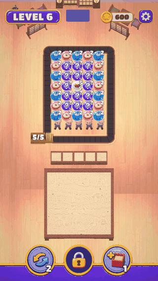
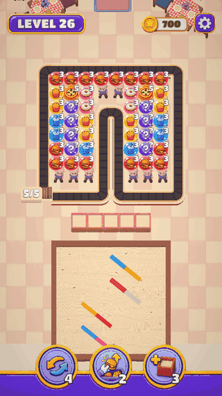
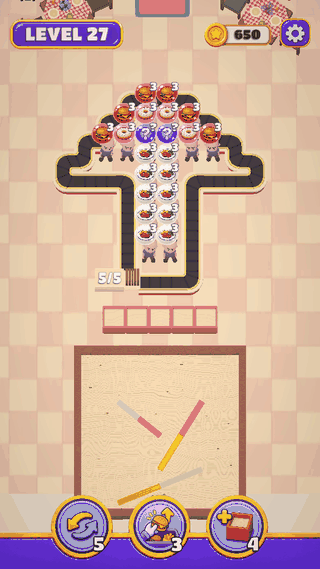

<h1>Restaurant Loop</h1>

A conveyor-belt puzzle game. Send food from the queue onto the belt, let it ride past the customers who ordered it, and keep the exit rack from filling up.

<h2>Gameplay</h2>

<table>
  <tr>
    <td align="center"><b>Easy</b><br/>Level intro, serving, win</td>
    <td align="center"><b>Linked Meals</b><br/>Pairs that ride together</td>
    <td align="center"><b>Power-Ups</b><br/>Shuffle, pick from bottom, extra tray</td>
  </tr>
  <tr>
    <td></td>
    <td></td>
    <td></td>
  </tr>
</table>

<h2>Features</h2>

- **30 levels** across two themes (Asian and Italian), with easy, hard and super hard difficulties.
- **Customers** see along the belt; hidden customers are revealed as their neighbours are served, some order twice.
- **Linked meals** leave the queue and ride the belt as a pair.
- **Power-ups:** Shuffle, Pick From Bottom and Extra Tray, unlocked by level and bought with coins.
- **Lives, coins and Keep Playing** after a fail; progress is saved with Easy Save 3.
- **Tutorials** authored per level in the editor.
- Safe-area HUD and aspect-aware camera framing for tall phones and tablets.

<h2>Tech Stack</h2>

- **Engine:** Unity 6000.0.64f1, URP
- **DI:** Zenject (SignalBus for game events)
- **Animation:** DOTween
- **Save:** Easy Save 3
- **Customers:** Vertex Animation Texture (VAT) baked animations
- **Shaders:** Toony Colors Pro
- **UI:** uGUI + TextMesh Pro, UI Toolkit for editor tools

<h2>Getting Started</h2>

1. Clone the repository:

   ```bash
   git clone https://github.com/huseyinbaglayici/Restaurant_Loop.git
   ```

2. Open the folder with **Unity 6000.0.64f1** from Unity Hub.
3. Open `Assets/Scenes/BoostrapScene.unity` and press **Play**.
4. Editor tools are under the **RestaurantLoop** menu (Conveyor Grid Tool, Showcase Mode, Test Mode, VAT baker).

See [`Docs/ConveyorSystem.md`](Docs/ConveyorSystem.md) for how the belt, queue and level editor fit together.
