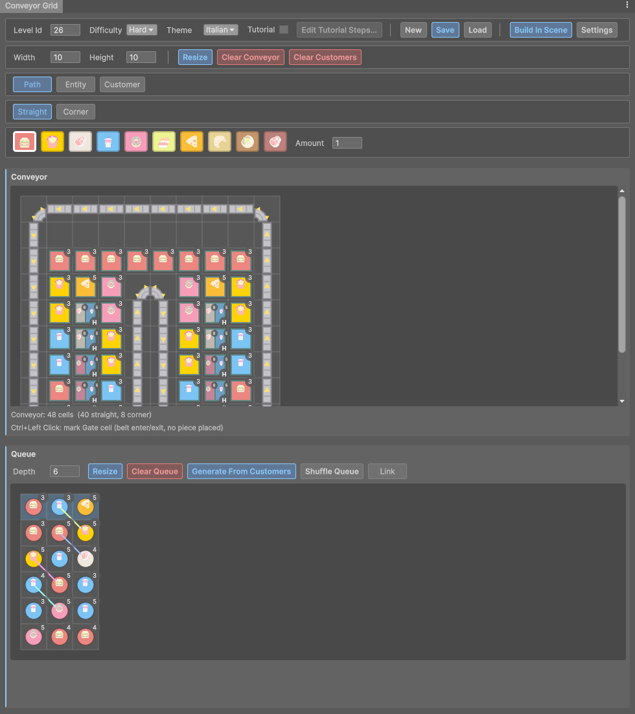

<h1>Restaurant Loop</h1>

<h2>Gameplay</h2>

<table>
  <tr>
    <td align="center"><b>Easy</b><br/>Level intro, serving, win</td>
    <td align="center"><b>Linked Meals</b><br/>Pairs ride the belt together</td>
    <td align="center"><b>Power-Ups</b><br/>Shuffle, pick from bottom, extra tray</td>
  </tr>
  <tr>
    <td></td>
    <td></td>
    <td></td>
  </tr>
</table>

<br/>

<h2>Level Editor</h2>

<table>
  <tr>
    <td align="center"><b>Conveyor Grid</b><br/>Belt path, customers, queue lanes, linked meals</td>
  </tr>
  <tr>
    <td></td>
  </tr>
</table>

<br/>

<h2>Tech Stack</h2>

- **Engine:** Unity 6000.0.64f1, URP
- **DI:** Zenject
- **Animation:** DOTween
- **Save:** Easy Save 3
- **Characters:** Vertex Animation Textures (VAT)
- **Shaders:** Toony Colors Pro
- **UI:** uGUI + TextMesh Pro, UI Toolkit for the editor tools

<h2>Getting Started</h2>

1. Clone the repository:

   ```bash
   git clone https://github.com/huseyinbaglayici/Restaurant_Loop.git
   ```

2. Open the folder with **Unity 6000.0.64f1** from Unity Hub.
3. Open `Assets/Scenes/BoostrapScene.unity` and press **Play**.
4. Editor tools are under the **RestaurantLoop** menu (Conveyor Grid Tool, Showcase Mode, Test Mode, ...).
